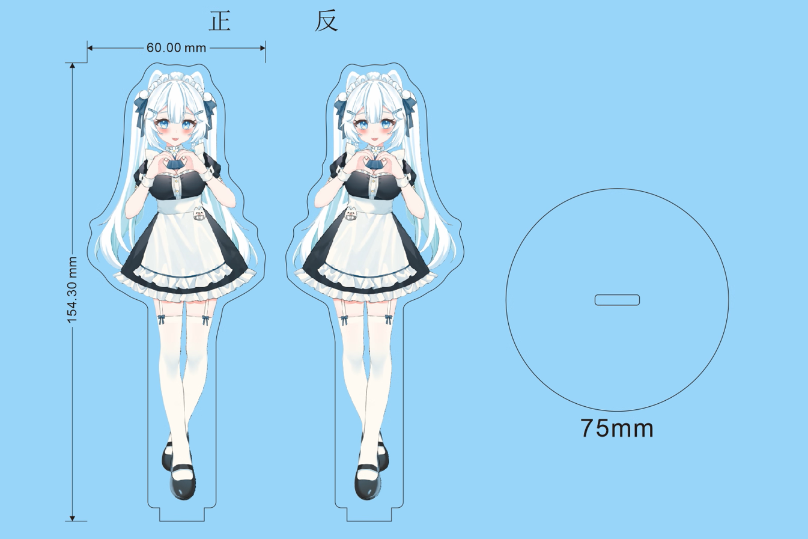
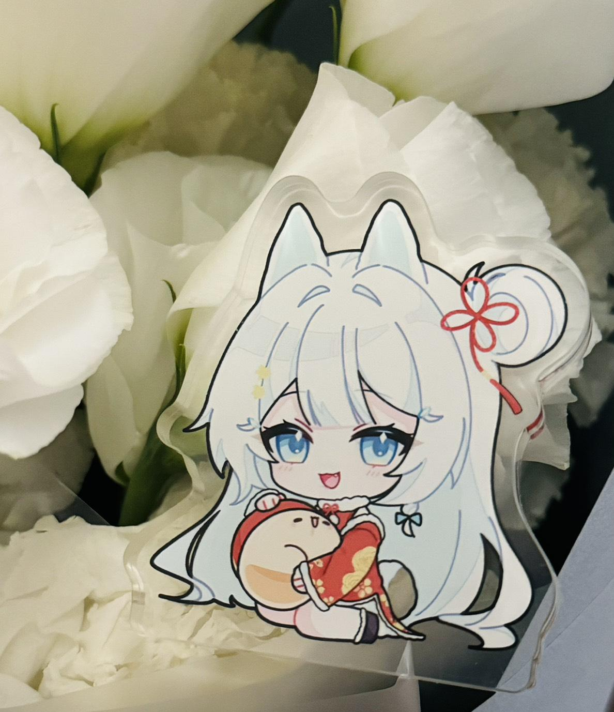
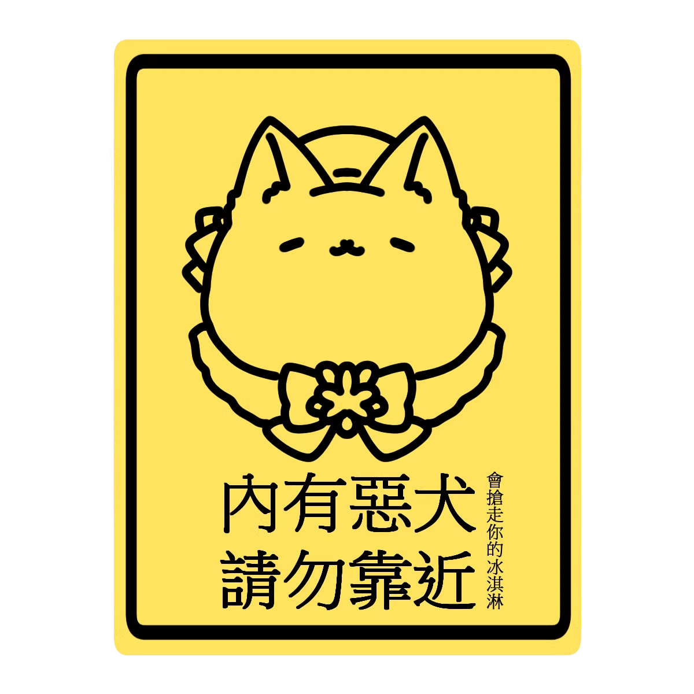
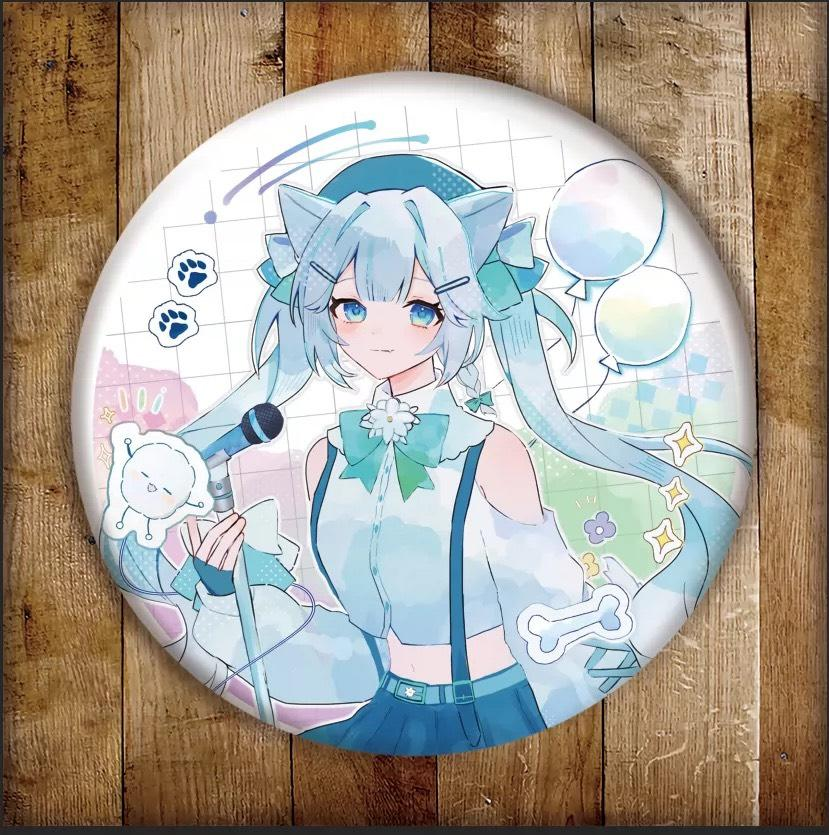

<p align="center">
  
</p>

<h1 align="center">【多帕 11 月運動會】規則</h1>

<p align="center">
  <b>投罐罐時間　2026/11/9（一）00:00 ～ 11/11（三）23:59</b>
</p>

> 11 月了！本月開始使用**新的大冒險**，歡迎投稿 → [大冒險投稿_NEW](https://docs.google.com/spreadsheets/d/1ivl7V10hiVKbT46qg3blLfUndIXp8aS6gUrWw1F-ZI0/edit?usp=sharing)
> 也歡迎賭上尊嚴，跟我 Battle！(｀・ω・´)

---

## 先看這裡 (・ω・)ノ

| 項目 | 內容 |
|---|---|
| 投罐罐時間 | **2026/11/9（一）00:00 ～ 11/11（三）23:59** |
| 活動時間 | 統一於開台時進行（開台時間請見 DC 群公告或開台通知） |
| 人不在怎麼辦？ | 已完成斗內但活動時不在場，多帕會依規則代玩 |
| 本月新制 | 大冒險改用新投稿，並開始對難度分級（0～3 級） |

---

## 活動怎麼運作 (・∀・)

整份規則只有兩種東西：**遊戲**和**獎品**。

1. 你用罐罐（或忠誠點數）玩**遊戲**。
2. 遊戲的結果有兩種：直接開出**獎品**，或是拿到**一般轉盤的轉動次數**。
3. 一般轉盤轉出**獎品**。獎品大多是狗要做的事（深蹲、健身環、大冒險），少數是你拿到的東西（周邊、識人券）。

```
罐罐 ──→ 遊戲 ──┬──→ 一般轉盤次數 ──→ 獎品
                └──→ 直接開出獎品
```

下面分成兩部分：**第一部分「遊戲」**講怎麼花罐罐，**第二部分「獎品」**講會開出什麼。

---

# 第一部分：遊戲 (・ω<)☆

## 遊戲一覽

| 類型 | 遊戲 | 價格 | 結果 |
|---|---|---|---|
| 直接轉／抽 | 一般轉盤 | 250 罐罐／轉（買 4 送 1） | 一定開出一個獎品 |
| 直接轉／抽 | 大冒險一番賞 | 1000 罐罐／抽 | 大冒險（0／1／3 級）或槓龜 |
| 直接轉／抽 | 忠誠點數扭蛋 | 1000 忠誠點數／次 | 喝水、深蹲、大冒險點數、周邊 |
| 小賭，押中才有 | 俄羅斯轉盤 | 100 罐罐／次 | 押中 → 自選任一轉盤的任一獎品 |
| 小賭，押中才有 | 骰子猜奇偶 | 100 罐罐／次 | 押中 → 一般轉盤 1 次 |
| 對戰，贏多帕才有 | 快艇骰子 | 500 罐罐的倍數 | 贏 → 一般轉盤 3 次 × 倍數 |
| 對戰，贏多帕才有 | 21 點 | 200 罐罐的倍數 | 贏 → 一般轉盤 1 次 × 倍數 |
| 對戰，贏多帕才有 | 猜顏色 | 200 罐罐的倍數 | 贏 → 一般轉盤 1 次 × 倍數 |
| 直接斗內 | 斗內備註【大冒險】 | 任意金額 | 累積進度條，達標轉大冒險轉盤 |

## 直接轉／抽

### 一般轉盤 — 250 罐罐／轉
- 買 4 送 1：買 4 轉可轉 5 轉
- 一定會開出一個獎品，獎項與機率見第二部分

### 大冒險一番賞 — 1000 罐罐／抽
- 共 99 枚
- 抽中大冒險**直接執行，不需集點**
- 一般轉盤也有 3% 機率送你抽 1 次

| 內容 | 機率 |
|---|---|
| 槓龜 | 66.67% |
| 0 級大冒險 | 20.20% |
| 1 級大冒險 | 10.10% |
| 3 級大冒險 | 3.03% |

### 忠誠點數扭蛋 — 1000 忠誠點數／次
- 每人每場直播最多兌換 1 次
- 大冒險點數被抽完後，扭蛋機會重製

| 內容 | 權重 | 機率 |
|---|---|---|
| 喝水 | 45 | 50% |
| 深蹲 ×1 | 20 | 22% |
| 大冒險點數 | 10 | 11% |
| 深蹲 ×5 | 10 | 11% |
| 周邊 | 5 | 6% |

## 小賭，押中才有

### 俄羅斯轉盤 — 100 罐罐／次
1. 押轉盤上的任一數字（0～36，一次只能押一個）
2. 轉中 → 可指定任一轉盤的任一獎品（例：大冒險 ×1）
3. 沒中 → 什麼都沒有

### 骰子猜奇偶 — 100 罐罐／次
1. 押「奇」或「偶」
2. 多帕擲 2 顆骰子，點數相加
3. 和為奇數＝「奇」，偶數＝「偶」
4. 押中 → 一般轉盤 1 次；沒中 → 什麼都沒有

## 對戰，贏多帕才有 (ง •̀_•́)ง

多帕操作遊戲，你口頭指揮。

| 遊戲 | 下注單位 | 輸 | 贏 |
|---|---|---|---|
| 快艇骰子 | 500 罐罐（可押倍數） | 0 次 | 一般轉盤 **3 次 × 倍數** |
| 21 點 | 200 罐罐（可押倍數） | 0 次 | 一般轉盤 **1 次 × 倍數** |
| 猜顏色 | 200 罐罐（可押倍數） | 0 次 | 一般轉盤 **1 次 × 倍數** |

**範例**
- 快艇骰子投 2000（500 × 4 倍），贏了轉 3 × 4 ＝ **12 次**
- 21 點投 400（200 × 2 倍），贏了轉 1 × 2 ＝ **2 次**
- 猜顏色投 1000（200 × 5 倍），贏了轉 1 × 5 ＝ **5 次**

**對戰流程**
1. **排隊**：到 DC 活動頻道排隊，留言想挑戰的項目。每次排隊限一局，想再挑戰要重新排隊。
2. **投幣**：把這一局的賭注投入綠界／歐付寶／山羌。
3. **等待**：多帕會在直播上唱名。輪到你時，進入活動語音頻道連線，口頭指揮多帕操作遊戲。

## 直接斗內

### 斗內備註【大冒險】
本月累計金額達標，就轉大冒險轉盤：

| 累積金額 | 可轉次數 |
|---|---|
| 3,000 | 第 1 次 |
| 8,000 | 第 2 次 |
| 15,000 | 第 3 次 |

- 本月上限 3 次，不受運動轉盤影響
- 每月 1 號歸零，未達成不累計到下個月
- 若因企劃限制或其他因素本月無法完成，至少會有相關企劃的進度與籌備

---

# 第二部分：獎品 ヽ(´ー`)ノ

## 獎品一覽

| 獎品 | 誰承受 | 說明 | 從哪裡開出 |
|---|---|---|---|
| 深蹲 ×1／×5／×10 | 狗 | 當場做 | 一般轉盤、扭蛋 |
| 健身環 5／10／15 分鐘 | 狗 | 當場玩 | 一般轉盤 |
| 喝水 | 狗 | 補充水分 | 扭蛋 |
| 大冒險（0～3 級） | 狗 | 觀眾投稿的挑戰，依難度分級，詳見下方 | 一番賞、大冒險轉盤、俄羅斯轉盤 |
| 大冒險點數 | 累積用 | 集滿 10 點 → 大冒險轉盤 1 次 | 一般轉盤、扭蛋 |
| 周邊 1 個 | 你 | 四選一，不要實體可換同機率選項 | 一般轉盤、扭蛋 |
| 帕寶識人券 | 你 | 指定帕寶認識任意一位觀眾，資料用於帕寶 GPT 與圖奇帕寶 BOT | 一般轉盤 |
| 請主播喝一杯 | 無 | 銘謝惠顧 | 一般轉盤 |
| 槓龜 | 無 | 一番賞沒中 | 一番賞 |

## 一般轉盤獎項與機率

| 獎品 | 機率 |
|---|---|
| 深蹲 ×5 | 25% |
| 健身環 5 分鐘 | 17% |
| 深蹲 ×10 | 16% |
| 周邊 1 個 | 10% |
| 請主播喝一杯 | 10% |
| 健身環 10 分鐘 | 8% |
| 大冒險點數 ×1 | 5% |
| 健身環 15 分鐘 | 3% |
| 大冒險一番賞 1 次 | 3% |
| 帕寶識人券 | 2% |
| 3 級大冒險轉盤 1 次 | 1% |

## 大冒險 (U・ω・U)

### 分級

| 等級 | 難度 | 主要來源（暫定） |
|---|---|---|
| 0 | 簡單 | 忠誠點數扭蛋集點／一番賞 |
| 1 | 普通 | 一番賞 |
| 2 | 困難 | 級距斗內轉盤 |
| 3 | 放過狗 | 月初運動轉盤（1%）／一番賞 |

### 怎麼讓狗做大冒險

| 路徑 | 怎麼做 | 得到 |
|---|---|---|
| 一番賞 | 1000 罐罐抽一次 | 抽中的等級直接執行 |
| 集點卡 | 大冒險點數集滿 10 點 | 大冒險轉盤 1 次 |
| 斗內進度條 | 備註【大冒險】累積 3,000／8,000／15,000 | 大冒險轉盤各 1 次，最多 3 次 |
| 一般轉盤 | 1% 機率 | 3 級大冒險轉盤 1 次 |
| 俄羅斯轉盤 | 押中數字 | 自選任一大冒險 |

### 大冒險轉盤內容
- 來源：[大冒險投稿_NEW](https://docs.google.com/spreadsheets/d/1ivl7V10hiVKbT46qg3blLfUndIXp8aS6gUrWw1F-ZI0/edit?usp=sharing)
- 只會以「**已審核**」的投稿進行轉盤
- 轉到重複或未通過的內容 → 重轉

## 周邊 ヽ(*´∀`)ノ

1. 女僕立牌（60 × 154.3 mm，底座直徑 75 mm）
2. 新年旗袍飯友
3. 徽章（約直徑 58 mm，三款任選）
4. 餓犬貼紙（A6／A7 任選）

<table>
  <tr>
    <td align="center"><br>1. 女僕立牌</td>
    <td align="center"><br>2. 新年旗袍飯友</td>
    <td align="center"><br>4. 餓犬貼紙</td>
  </tr>
  <tr>
    <td align="center"><br>3. 徽章（唱歌）</td>
    <td align="center"><br>3. 徽章（特寫）</td>
    <td align="center"><br>3. 徽章（貓帽）</td>
  </tr>
</table>
