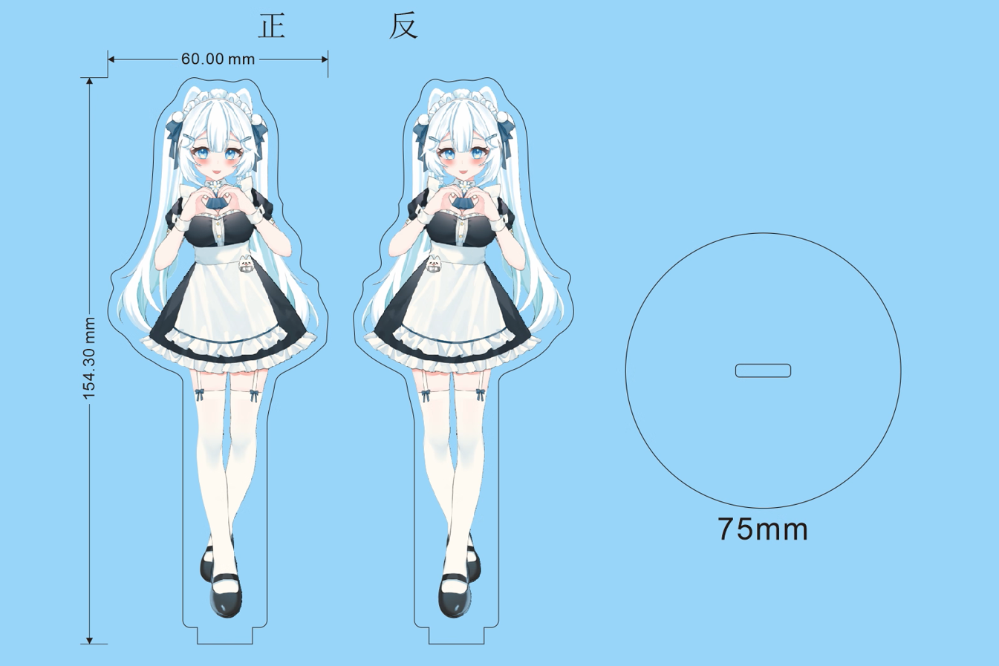
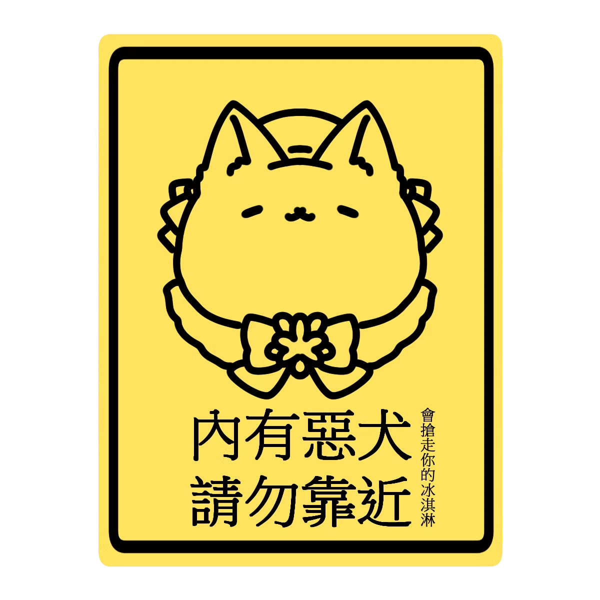
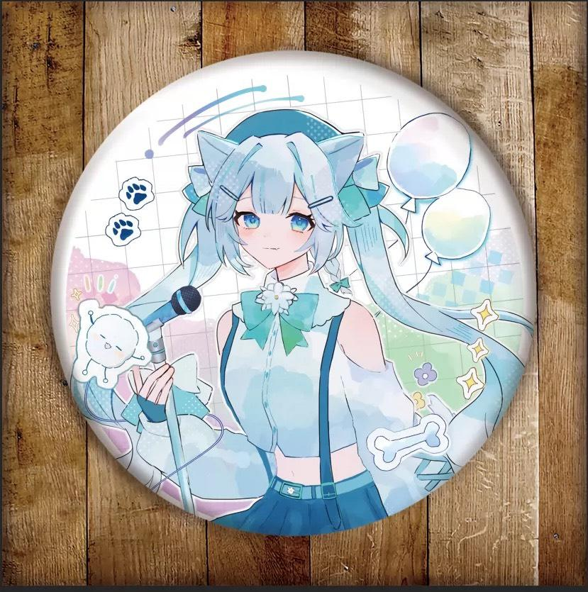

# 周邊清單 ヽ(*´∀`)ノ

跨月通用的周邊品項。一般轉盤抽到「周邊 1 個」時從這裡選，不要實體可換同機率的其他選項。

| 編號 | 品項 | 規格 | 狀態 |
|---|---|---|---|
| 1 | 女僕立牌 | 60 × 154.3 mm，底座直徑 75 mm | 供應中 |
| 2 | 新年旗袍飯友 | — | 供應中 |
| 3 | 徽章 | 約直徑 58 mm，三款任選 | 供應中 |
| 4 | 餓犬貼紙 | A6 或 A7，可任選 | 供應中 |

## 圖片

<table>
  <tr>
    <td align="center"> 1. 女僕立牌</td>
    <td align="center"> 2. 新年旗袍飯友</td>
    <td align="center"> 4. 餓犬貼紙</td>
  </tr>
  <tr>
    <td align="center"> 3. 徽章（唱歌）</td>
    <td align="center"> 3. 徽章（特寫）</td>
    <td align="center"> 3. 徽章（貓帽）</td>
  </tr>
</table>

## 更新方式
- 新增品項：往下加一列，編號連號
- 下架品項：狀態改成「已下架」，不要刪除，方便回顧
- 圖片放在 `周邊圖片/`，檔名用品項名稱
